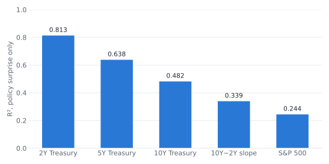
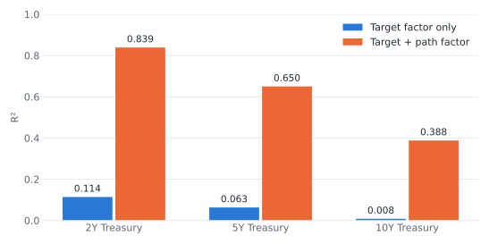

::: {.exec-summary}
**In one minute.** Central banks move markets with words as well as rates. I test whether the *wording* of Federal Reserve statements moves asset prices beyond the rate decision itself. The sample covers all 239 scheduled FOMC meetings from 1994 to 2023, with asset-price changes in a 30-minute window around each announcement. I measure statement language five ways, from a hand-built hawkishness dictionary to transformer models (FinBERT, CentralBankRoBERTa).

The market-implied policy surprise explains 81% of the move in 2-year yields. **None of the five text measures adds meaningful explanatory power on top of it.** Two results that first looked significant turned out to be artifacts of the policy regime.
:::

*Seminar paper, Finance Center Münster (Seminar Asset Pricing, 2026), graded 1.0. The extension to five text measures and the factor replication is ongoing work toward a working paper.*

## Research question

On 28 January 2004 the FOMC left rates unchanged, exactly as markets expected. Yet within thirty minutes, two- and five-year Treasury yields rose by roughly 20 and 25 basis points. The trigger was a change of wording: "considerable period" was replaced by "patient".

If words alone can move yields that much, communication is a policy instrument in its own right. This study asks two questions:

1. **Does FOMC statement language move asset prices beyond the rate decision?**
2. **If so, through which channel?** The literature proposes three:
   - **Policy signalling:** words shift expectations about the future rate path.
   - **Information:** words reveal the Fed's view of the economy.
   - **Uncertainty:** words change the risk premium on long-term bonds.

The uncertainty channel has a testable signature. It should move long maturities more than short ones, and so change the slope of the yield curve. Hansen, McMahon and Tong (2019) find this pattern for the Bank of England. This study tests whether it holds for the Fed.

## Data and methodology

**Sample.** All 239 scheduled FOMC meetings, February 1994 to December 2023. Unscheduled emergency announcements are excluded. Post-meeting statements are scraped from federalreserve.gov and cleaned of headers, voting paragraphs and other non-policy text. 209 meetings have a matched statement. Regressions in first differences use 208.

**Market data.** 30-minute asset-price changes around each announcement from Bauer and Swanson (2023):

- 2-, 5- and 10-year Treasury yields
- S&P 500 futures
- the slope of the yield curve (10Y − 2Y)

The benchmark is the **monetary-policy surprise** (*MPS*), the first principal component of high-frequency changes in short-rate futures (fed funds and Eurodollar contracts up to one year ahead).

**Five text measures**, from simple to expressive:

| Measure | What it captures |
|---|---|
| Bag-of-words hawkishness index | Hand-built dictionary of monetary-policy phrases ("removing accommodation", "considerable period"), matched longest-first so context is respected |
| FinBERT | Sentence-level financial tone from a transformer trained on financial news, averaged per statement |
| CentralBankRoBERTa | Transformer trained specifically on central-bank communication |
| LDA topic intensities | Share of each statement devoted to latent topics |
| RoBERTa embeddings | Contextual representation of the full statement |

The dictionary score is

$$
\text{BoW}_t = \frac{H_t - D_t}{H_t + D_t + 1},
$$

where $H_t$ and $D_t$ count hawkish and dovish phrases. Positive values mean a more hawkish statement.

**Estimation.** For each market outcome $k$:

$$
\Delta y_{t,k} = \alpha_k + \beta_k \, \text{MPS}_t + \gamma_k \, \Delta \text{Text}_t + \varepsilon_{t,k}
$$

Three design choices matter:

- **Text enters as a change from the previous statement.** A 30-minute price move can only react to new information. The pre-meeting tone is already known.
- **Multi-dimensional measures are tested jointly.** Topic and embedding blocks are tested with robust Wald tests.
- **Narrative shocks.** Following Hansen, McMahon and Tong (2019), each text measure is also residualised on four pre-meeting macro variables. This isolates the part of the language that the economic state does not predict.

All regressions are OLS with HC3 heteroskedasticity-robust standard errors.

## Key findings

### 1. The policy surprise dominates

The monetary-policy surprise is highly significant for every outcome, with the expected signs:

- **Treasury yields:** a hawkish surprise raises them at every maturity. The effect is strongest at two years.
- **Equities:** the S&P 500 falls.
- **Yield curve:** it flattens.

{fig-alt="Bar chart of R-squared from the monetary-policy surprise alone: 2-year Treasury 0.813, 5-year 0.638, 10-year 0.482, 10-year minus 2-year slope 0.339, S&P 500 0.244."}

| Outcome | Coefficient on *MPS* | Robust s.e. | R² |
|---|---|---|---|
| 2Y Treasury | 0.831*** | 0.053 | 0.813 |
| 5Y Treasury | 0.744*** | 0.057 | 0.638 |
| 10Y Treasury | 0.520*** | 0.049 | 0.482 |
| S&P 500 | −4.728*** | 0.682 | 0.244 |
| 10Y − 2Y slope | −0.311*** | 0.045 | 0.339 |

: Baseline regressions, N = 239. \*\*\* p < 0.01. {.striped}

### 2. Statement language adds almost nothing on top

Across five text measures and five outcomes, the extra R² from adding text is close to zero:

| Measure | 2Y | 5Y | 10Y | S&P 500 | 10Y−2Y |
|---|---|---|---|---|---|
| BoW dictionary | +0.002 | +0.003 | +0.007 | +0.002 | +0.002 |
| FinBERT | +0.000 | +0.000 | +0.000 | +0.010 | +0.000 |
| CentralBankRoBERTa | +0.005\* | +0.004 | +0.007 | +0.005 | +0.000 |
| LDA topics | +0.004 | +0.006 | +0.011 | +0.006 | +0.036 |
| RoBERTa embeddings | +0.003 | +0.007 | +0.009 | +0.069\*\*\* | +0.023\*\* |

: Increase in R² over the surprise-only model. Stars show joint significance of the text coefficients (robust Wald test). The embedding row uses component levels. That result is diagnosed in finding 4 and does not survive. {.striped}

- **The dictionary** does classify statements plausibly. The most hawkish ones cluster in the 2005–07 and 2015–18 tightening cycles; the most dovish in the 2008 crisis years and the early-2000s recession. Its coefficients also have the right sign, yet none is statistically significant.
- **FinBERT** shows only a weak, insignificant link to equity returns.
- **Slope regressions**, the direct test of the uncertainty channel, are insignificant for every text measure.
- **Narrative shocks**, the residualised text measures, are insignificant too.

### 3. The null is not an artifact

One worry is that the policy surprise simply absorbs the text signal. It does not. The text surprises are almost uncorrelated with it: correlations range from −0.07 to +0.08. The text varies independently; it just does not predict prices.

### 4. Two apparent positives, diagnosed and rejected

- **Topic levels** seemed to explain S&P 500 moves (p = 0.005).
  - The effect vanishes when the change in topics is used instead (p = 0.936). That is the specification consistent with the event-study design.
  - It also loses significance once a post-2008 regime indicator is added (p = 0.092).
  - So topic levels were tracking the policy era, not announcement news.
- **Embedding levels** show the same pattern. Their first principal component correlates −0.719 with the calendar year.
- **One marginal survivor.** Embedding *changes* remain linked to the 10Y−2Y slope (p = 0.009). The link weakens outside the zero lower bound (p = 0.095) and when crisis statements are excluded (p = 0.077). It is reported as suggestive only.

### 5. Replicating the target/path decomposition

As a benchmark, I rebuild the target and path factors of Gürkaynak, Sack and Swanson (2005) from raw futures data. The data come from the SF Fed's U.S. Monetary Policy Event-Study Database. The replication reproduces their pattern: news about the future path of policy, not the current rate decision, drives longer-term yields.

{fig-alt="Grouped bar chart. 2-year Treasury: target factor only 0.114, target plus path 0.839. 5-year: 0.063 and 0.650. 10-year: 0.008 and 0.388."}

## Interpretation

*The findings above are what the data show. This section is my reading of them.*

The policy surprise is measured in the same 30-minute window as the price moves. It therefore already captures the policy-path part of any news, including news carried by statement wording. What the text coefficients test is the effect of language *outside* the expected policy path. The obvious candidate is the term premium, which is the uncertainty channel.

On that reading:

- **Policy signalling** is captured by the surprise itself.
- **The information channel** gets only weak, fragile support (FinBERT on equities).
- **The uncertainty channel** gets no support in FOMC statements, unlike the Bank of England evidence.

There is also a methodological lesson. Dictionaries are transparent but too coarse to read context. Transformer models read tone well, but they mix up financial sentiment with policy stance: strong-growth language can sound "positive" while being hawkish.

For practitioners, the implication is narrow. In the announcement window, the market-implied surprise is the signal. Off-the-shelf tone scores of the statement add little beyond it.

## Limitations

- **Statements only.** Press conferences, minutes and speeches are excluded, and they may carry the richer signal.
- **Immediate reactions only.** The 30-minute window cannot see slower effects on expectations.
- **Model fit.** FinBERT is trained on financial news, not central-bank language. CentralBankRoBERTa addresses this partly, but a model trained for hawkish/dovish classification on FOMC text could do better.
- **Different setting.** The contrast with the Bank of England may reflect institutions, document type, or text method. This design cannot separate them.

## Supporting materials

- **Code:** [github.com/ehsankhoddamy/fomc-statements-asset-prices](https://github.com/ehsankhoddamy/fomc-statements-asset-prices). Full pipeline in Python, including text measures, factor construction, regressions and diagnostics.
- **Data:**
  - Bauer and Swanson (2023) monetary-policy surprises, Federal Reserve Bank of San Francisco
  - U.S. Monetary Policy Event-Study Database (Acosta et al., 2025)
  - FOMC statements from federalreserve.gov
- **Key references:**
  - Gürkaynak, Sack and Swanson (2005), *International Journal of Central Banking*
  - Hansen, McMahon and Tong (2019), *Journal of Monetary Economics*
  - Bauer and Swanson (2023), *NBER Macroeconomics Annual*
  - Araci (2019), FinBERT
