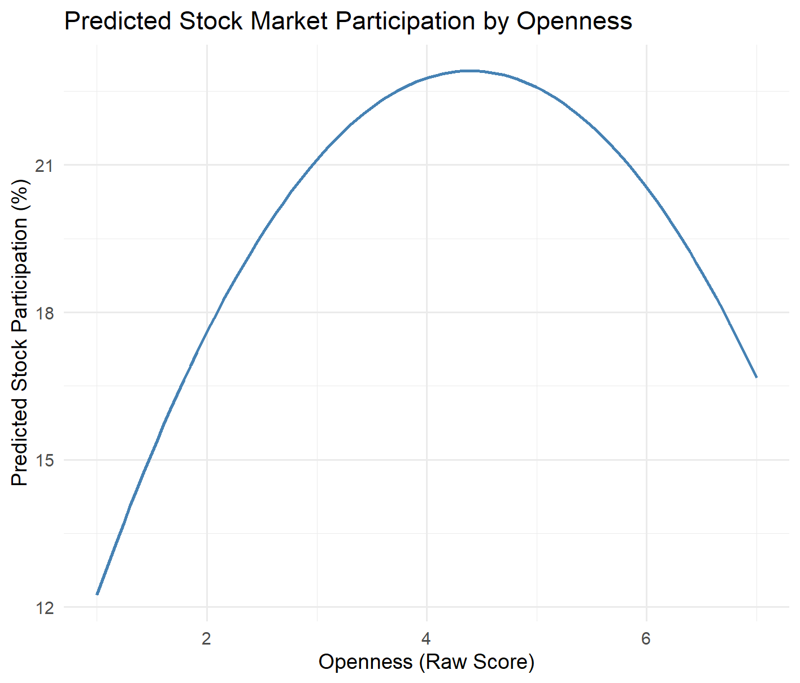

::: {.exec-summary}
**In one minute.** Households with similar income, wealth and education often make very different investment choices. Many hold no stocks at all. Using German household panel data (SOEP, 2005–2017), I test whether the Big Five personality traits help explain this, and *through which channel*.

- **Risk appetite:** personality strongly predicts how much risk people are willing to take.
- **Openness:** it affects stock ownership almost entirely through risk tolerance. About 62% of its effect is mediated, and the relationship is inverse-U shaped.
- **Who decides:** which traits matter depends on whether a person decides alone or as head of a larger household.
:::

*Seminar paper, Advanced Finance, University of Münster (Summer 2025). Replicates and extends Jiang, Peng and Yan (2024, Journal of Financial Economics) on German data.*

## Research question

Standard portfolio theory says households with similar resources should invest similarly. They do not. This study asks whether stable personality differences help close that gap.

Personality probably does not drive portfolio choice directly. The more plausible route is indirect. Traits shape what people *believe* about markets and how much risk they are *willing to bear*. Those two things, in turn, shape whether they own stocks.

```
Big Five traits ──► beliefs about markets ──► stock market participation
                ──► risk willingness      ──►
```

## Data and methodology

**Data.** The German Socio-Economic Panel (SOEP) is a nationally representative household survey. The study uses the 2005, 2009, 2013 and 2017 waves, the years in which the Big Five inventory is fielded.

| Variable | Measure |
|---|---|
| Big Five traits | 16 survey items, averaged per trait and standardised |
| Stock participation | Owns stocks or equity funds (0/100, so coefficients read as percentage points) |
| Beliefs | Concern about financial market stability (2009, 2013) |
| Risk willingness | Self-reported general willingness to take risks (2009, 2013, 2017) |
| Controls | Age, sex, years of education, labour income, net wealth, net debt, year fixed effects |

**Identifying the decision maker.** Personality is measured for individuals, but stock ownership is recorded per household. In a multi-person household, the respondent may not be the one who invests. The sample is therefore split into:

- **one-person households**, where the respondent clearly is the decision maker, and
- **heads of multi-person households**.

**Methods:**

- **Main models:** OLS with heteroskedasticity-robust standard errors.
- **Robustness:** logit and probit, since participation is a yes/no outcome.
- **Channels:** causal mediation analysis following Imai, Keele and Tingley (2010), with 1,000 bootstrap replications.
- **Non-linearity:** a quadratic Openness term, tested against the linear model with likelihood-ratio tests rather than assumed.
- **Measurement:** principal component analysis checks that the survey items load on the traits they should.

## Key findings

### 1. Personality strongly predicts risk willingness

| Trait | Effect on general risk willingness |
|---|---|
| Openness | +0.424*** |
| Extraversion | +0.303*** |
| Conscientiousness | −0.127*** |
| Agreeableness | −0.265*** |
| Neuroticism | −0.285*** |

: OLS with demographic controls and year fixed effects. N = 38,949, R² = 0.152. \*\*\* p < 0.01. {.striped}

Open and extraverted people report more willingness to take risks. Conscientious, agreeable and neurotic people report less. This matches prior research. Neuroticism is also the strongest predictor of concern about financial markets (N = 21,909).

### 2. Which traits matter depends on who decides

| Trait | One-person households | Heads of multi-person households |
|---|---|---|
| Openness | −2.129*** | −0.328 |
| Conscientiousness | −0.957* | −2.365*** |
| Extraversion | −1.153** | −0.143 |
| Agreeableness | −0.540 | −1.972*** |
| Neuroticism | −1.291*** | −0.503 |
| Observations | 8,663 | 15,166 |

: Effect on stock market participation, in percentage points per standard deviation. \* p < 0.1, \*\* p < 0.05, \*\*\* p < 0.01. {.striped}

- **People deciding alone:** Openness, Extraversion and Neuroticism matter.
- **Household heads:** Conscientiousness and Agreeableness matter instead.

Individual dispositions seem to be diluted when financial decisions are shared. The models explain about 10–12% of the variation in stock ownership, which is typical for household finance.

### 3. Openness has an inverse-U relationship with participation

The negative linear coefficient on Openness is misleading. A quadratic term fits significantly better in both groups (likelihood-ratio tests: p = 0.0002 and p = 0.0057).

Participation rises with moderate Openness and falls again at high levels. One explanation is overanalysis or distraction. Another is measurement: the PCA shows that two Openness items (aesthetic appreciation and abstract thinking) load diffusely, so the trait may mix facets with opposite effects.

{fig-alt="Line chart of predicted stock market participation against Openness raw score from 1 to 7. Participation rises from about 12 percent to a peak of about 22 percent near the middle of the scale, then falls to about 17 percent at the top."}

### 4. Openness works through risk tolerance

The mediation analysis separates each trait's effect on participation into two parts:

- an **indirect** part that runs through the channel (ACME), and
- a **direct** part (ADE).

| Path | Indirect effect (ACME) | Direct effect (ADE) | Share mediated |
|---|---|---|---|
| Openness → risk willingness → participation | 0.292 (p = 0.001) | 0.180 (p = 0.450) | 62% (p = 0.002) |
| Neuroticism → beliefs → participation | 0.108 (p = 0.002) | −0.443 (p = 0.280) | not identified |

: Causal mediation, 1,000 bootstrap replications. {.striped}

Openness affects participation almost entirely *through* higher risk tolerance, not directly. For Neuroticism, the indirect path is significant but the total effect is not (p = 0.418). The share mediated therefore cannot be interpreted, and the result is treated as suggestive only.

### 5. Results hold in non-linear models

Logit and probit models reproduce the OLS conclusions:

- Conscientiousness is robustly negative.
- Neuroticism and Extraversion are weakly negative.
- Openness and Agreeableness are insignificant in linear form.

## Interpretation

*The findings above are what the data show. This section is my reading of them.*

Personality is a meaningful but context-dependent driver of investment behaviour. It works mainly through risk preferences rather than directly. Modelling traits as non-linear and mediated predictors captures patterns that a simple linear model hides; the Openness result is the clearest example.

For financial advisors and fintech products, short personality profiles could help match investment approaches to clients. Highly open clients may favour strategies that balance novelty with simplicity. Clients high in Neuroticism may benefit from more structured, reassuring portfolios.

## Limitations

- **Associations, not causal effects.** Personality is stable by design, so there is little within-person variation to exploit. The mediation results rely on assumptions (sequential ignorability) that these data cannot verify.
- **The belief channel may run backwards.** On the corrected coding, more concern about markets goes with *higher* participation. That fits reverse causality: people who own stocks follow markets and worry more. The Neuroticism result should be read as an association.
- **Wealth is carried across waves.** The SOEP wealth module is not fielded every year, so wealth and debt are carried forward or backward from the nearest module.
- **Openness is measured less cleanly** than the other traits, which may contribute to the non-linear pattern.

## Supporting materials

- **Code:** [github.com/ehsankhoddamy/personality-traits-investment-decisions](https://github.com/ehsankhoddamy/personality-traits-investment-decisions). Full R pipeline covering cleaning, variable construction, estimation and figures.
- **Data:** German Socio-Economic Panel (SOEP), waves 2005–2017. SOEP data cannot be redistributed; access for research is free via [DIW Berlin](https://www.diw.de/soep).
- **Key references:**
  - Jiang, Peng and Yan (2024), *Journal of Financial Economics*
  - Imai, Keele and Tingley (2010), *Psychological Methods*
  - Becker et al. (2012), *Annual Review of Economics*
